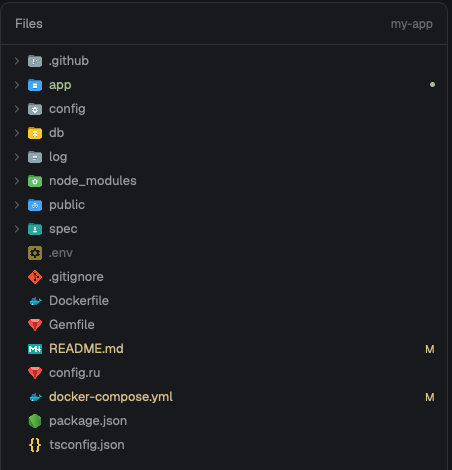

# herdr-editor

A file sidebar like VS Code's, with an editor: the person's own file icon theme,
compact rows, git colors on names, and files that open in place to edit and save.

**What you see:** a right panel titled Files with the project name on the right. Rows
are 24px with 12px of indent per level: a 12px chevron for folders, a 16px icon, and
the name in the theme's muted text. New files are ansi2, changed files ansi3, deleted
and conflicted ones ansi1, each with a letter on the right (U, M, D, !). Ignored names
are dim, with the icon at 0.55 opacity. A folder holding changes takes their color and
a 5px dot. The selected row uses `selected`. An open file replaces the tree: a back
arrow, the path, a 7px ansi3 dot while unsaved and a Save button.

**How it behaves:** a click on a folder opens it, a click on a file opens the editor.
`cmd-s` or Save writes the file. If the disk changed, a bar says "This file changed on
disk." with Reload and Overwrite, and nothing is written. With nothing unsaved, a file
changed elsewhere reloads by itself. The back arrow with unsaved changes asks for
Save, Discard or Cancel. Moving to a pane in another folder keeps an unsaved file open.
Files on another machine and over 400 KB are read only.

**Built from:** a mod in a block in place of `files`, in a clone of `main`. It uses
`exec` for `git`, `sh`, `cat` and `tar`, plus `readTextFile`, `writeTextFile`,
`watchFolder`, `nextCommand`, and `Editor` from gpui-base. `icons.js` finds
`workbench.iconTheme` in the settings of VS Code, Cursor, Insiders or VSCodium, finds
the extension in its folder, and copies the theme's SVG and PNG files to
`data/herdr-editor/icons/<theme>`. Lookup follows VS Code: exact name, longest
extension, language id, default.

**Watch out:** it reads your editor's settings and extensions in your home folder, and
runs programs. `set_value` fires no `change` event, so unsaved state is read from the
editor, never kept from events. Seti and other font themes have no files to copy, so
plain icons show. `data/` is the only place outside the mod that it writes.

**Done when:** `herdr-app check` passes. With an SVG theme active, rows show its icons.
With none, rows show plain icons. Editing, then saving, writes the file with its line
endings. Changing the file on disk while editing shows the bar and keeps the disk as
it was.
